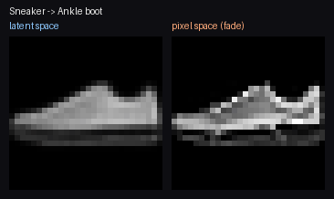
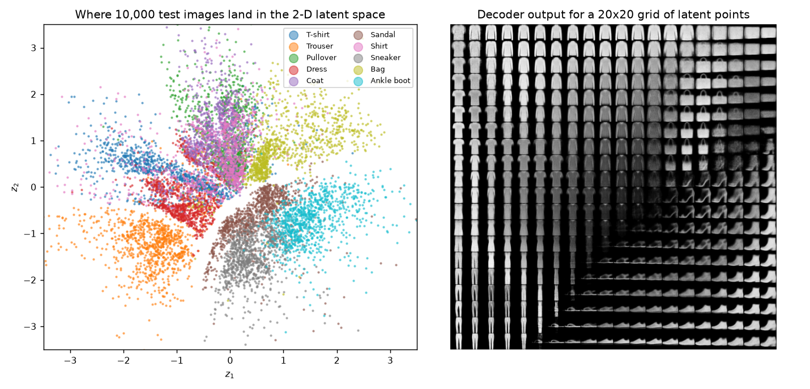
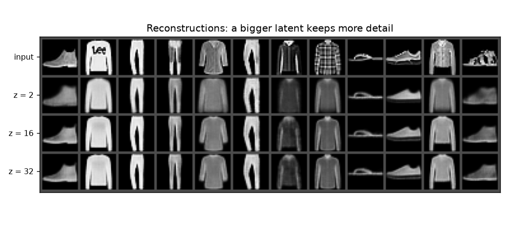
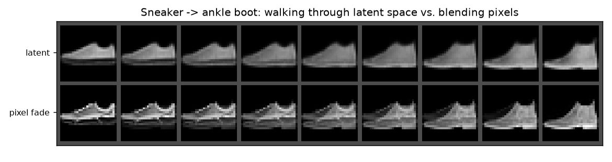
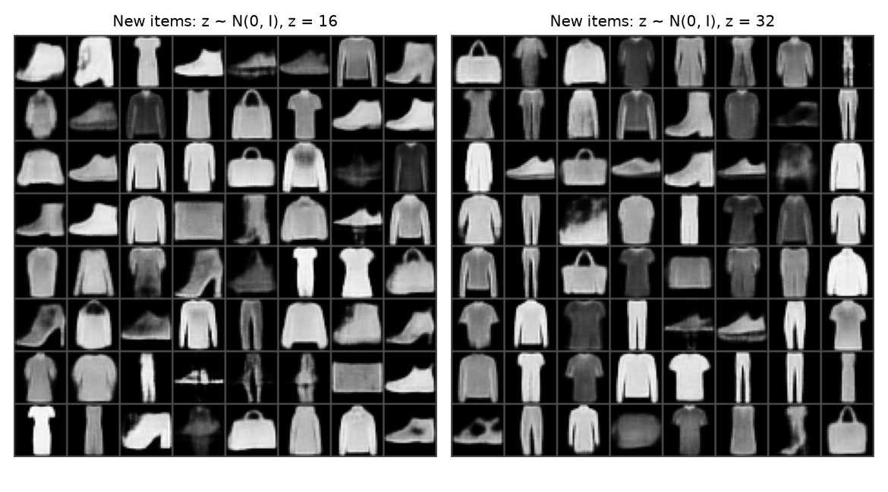
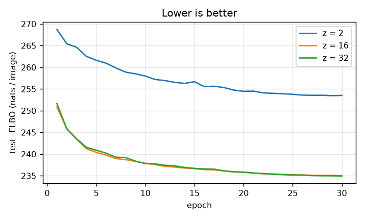

# VAE latent space: morphing a sneaker into a boot

A **variational autoencoder** written from scratch in PyTorch and trained on Fashion-MNIST. It squeezes
each 28 × 28 clothing image into a handful of numbers (the *latent code*) and learns to rebuild the image
from them. Because the latent space is trained to be smooth and to look like a standard Gaussian, you
can walk through it: points between a sneaker and a boot decode to believable in-between shoes, while
blending the pixels only gives a ghostly double exposure.



*Left: walking in a straight line through the 16-d latent space. Right: fading the pixels for comparison.*

## Results

Fashion-MNIST test set (10,000 images never used in training). All numbers are in nats per image
(lower is better); the IWAE column is the tighter likelihood bound with 100 samples.

| latent size | −ELBO | = reconstruction | + KL | −log p(x), IWAE k = 100 | bits per pixel | dimensions actually used* |
|---|---|---|---|---|---|---|
| z = 2 | 253.4 | 246.6 | 6.8 | 251.7 | 0.463 | 2 of 2 |
| z = 16 | 235.0 | 220.0 | 15.0 | 233.5 | 0.430 | 11 of 16 |
| z = 32 | 235.0 | 219.7 | 15.2 | 233.4 | 0.430 | 11 of 32 |

\* a dimension counts as used if its average KL on the test set is above 0.05 nats (`results/active_dims.json`). In the others the
encoder outputs exactly the prior, $\mathcal N(0, 1)$, whatever the image.

What the numbers say:

- **Going from 2 to 16 latent numbers helps a lot**: the reconstruction error drops by 27 nats per
  image, and the model pays for it with 8 more nats of KL (information stored in the code).
- **Going from 16 to 32 helps almost nothing, and the table shows why.** Both models switch on the same
  11 dimensions and leave the rest unused. The KL penalty makes every used dimension cost something,
  so the model stops at the number it needs for this dataset and decoder. This "posterior collapse"
  of extra dimensions is a known VAE behaviour, and here it is measured directly.
- **The ELBO is 1.5–1.8 nats looser than the IWAE bound** for every model, which is how far the
  encoder's simple Gaussian is from the true posterior.

## How it works, in plain words

1. **Encoder.** A small CNN reads the image and outputs not one code but a *cloud*: a mean $\mu$
   and a spread $\sigma$ for each latent dimension. "This image is somewhere around here."
2. **Sample.** Pick a random point from that cloud: $z = \mu + \sigma \cdot \varepsilon$ with
   $\varepsilon \sim \mathcal N(0, I)$. Writing the sample this way (the *reparameterisation trick*)
   keeps it differentiable, so the encoder can learn through it.
3. **Decoder.** A mirror-image CNN turns $z$ back into 784 pixel probabilities.
4. **Two pressures in the loss.** Rebuild the image well (reconstruction term), *and* keep every
   cloud close to a standard Gaussian (KL term). The second pressure is what packs the codes
   together without gaps, so any point you pick, including points between two images, decodes to
   something that looks like clothing.
5. **Generate.** Throw away the encoder, draw $z \sim \mathcal N(0, I)$, decode. New items.



*With only 2 latent numbers you can draw the whole space. Left: where the 10,000 test images land
(colours are labels the model never saw). Right: what the decoder draws at each point of a grid.
Trousers, bags, shoes and tops get their own regions, and the borders blend smoothly.*

## The core equations

Encoder $q_\phi(z\mid x) = \mathcal N(\mu_\phi(x), \operatorname{diag}\sigma^2_\phi(x))$, prior
$p(z) = \mathcal N(0, I)$, decoder $p_\theta(x\mid z) = \prod_{i=1}^{784}\operatorname{Bernoulli}(x_i;\ \pi_{\theta,i}(z))$.

The model is trained by maximising the **evidence lower bound** (ELBO) on $\log p_\theta(x)$:

$$\log p_\theta(x) \;\ge\; \mathcal L(x) = \underbrace{\mathbb E_{q_\phi(z\mid x)}\big[\log p_\theta(x\mid z)\big]}_{\text{reconstruction}} \;-\; \underbrace{D_{\mathrm{KL}}\big(q_\phi(z\mid x)\,\|\,p(z)\big)}_{\text{keep codes Gaussian}}$$

For a Gaussian encoder and a standard-normal prior, the KL term has a closed form:

$$D_{\mathrm{KL}} = \tfrac12\sum_{j=1}^{d}\left(\mu_j^2 + \sigma_j^2 - \log\sigma_j^2 - 1\right)$$

Reparameterisation: $z = \mu_\phi(x) + \sigma_\phi(x)\odot\varepsilon,\ \varepsilon\sim\mathcal N(0, I)$.

The test likelihood is reported with the tighter **importance-weighted bound** (IWAE, $k = 100$ samples):

$$\log p_\theta(x) \;\ge\; \mathbb E\left[\log \frac1k\sum_{i=1}^{k}\frac{p_\theta(x\mid z_i)\,p(z_i)}{q_\phi(z_i\mid x)}\right],\qquad z_i\sim q_\phi(z\mid x)$$

## More figures









## Training

| setting | value |
|---|---|
| data | Fashion-MNIST, 60,000 train / 10,000 test images, intensities in [0, 1] |
| encoder | 3 strided convs (32, 64, 128 channels) → 512 → $\mu$, $\log\sigma^2$ |
| decoder | 512 → 128 × 4 × 4 → 3 transposed convs → 28 × 28 Bernoulli logits |
| latent sizes | 2, 16 and 32, each trained separately |
| optimiser | Adam, lr 1e-3 with cosine decay, batch 128, 30 epochs |
| compute | about 75 s per epoch on a laptop CPU (8 threads), so about 40 minutes per model; it also runs on the M1 GPU |

## What I learned along the way

- **The two loss terms pull against each other, and the latent size decides who wins.** With 2
  numbers the model can't store much, so reconstructions are blurry but the space is easy to see.
  With 16 numbers reconstructions sharpen, and the KL term grows because more information is stored
  in the code. Given 32, the model still uses only 11: extra capacity isn't free under the KL term.
- **Blurry samples are expected, not a bug.** A per-pixel Bernoulli decoder treats pixels as
  independent given $z$, so it averages over plausible details instead of choosing one. Diffusion
  models and GANs exist largely to fix this.
- **The ELBO is a bound, not the likelihood.** The IWAE estimate with 100 samples is always a little
  tighter, and the gap shows how far the encoder's Gaussian is from the true posterior.
- **Interpolate in latent space, not pixel space.** The interpolation GIF is the clearest picture of
  what "a learned representation" means.

## Reproduce

```bash
git clone https://github.com/Nipuna-Lakruwan/vae-latent-space
cd vae-latent-space
uv sync
uv run python src/train.py --z 2 16 32 --epochs 30   # downloads Fashion-MNIST on first run
uv run python src/figures.py
uv run pytest
```

## Resume line

> Built a convolutional variational autoencoder from scratch in PyTorch (reparameterisation trick, closed-form KL, importance-weighted likelihood bound) on Fashion-MNIST; compared latent sizes 2/16/32 (test −log p(x) 251.7 → 233.5 nats) and showed by per-dimension KL that only 11 latent dimensions are used even when 32 are available, with latent-space interpolation and 2-D latent maps as visual results.

## References

- Kingma & Welling, *Auto-Encoding Variational Bayes*, 2014.
- Rezende, Mohamed & Wierstra, *Stochastic Backpropagation and Approximate Inference in Deep Generative Models*, 2014.
- Burda, Grosse & Salakhutdinov, *Importance Weighted Autoencoders*, 2016.
- Xiao, Rasul & Vollgraf, *Fashion-MNIST*, 2017.

MIT License.
